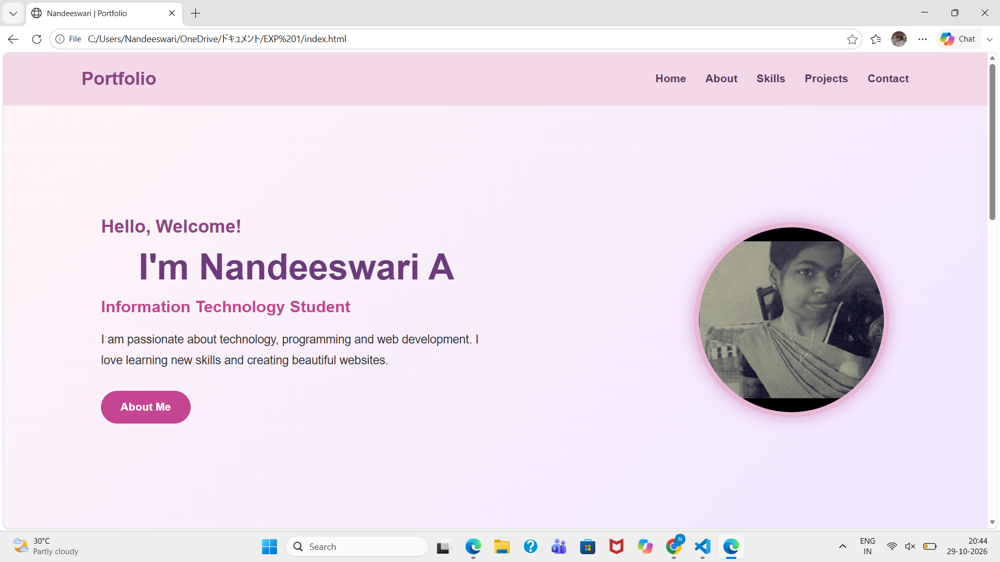
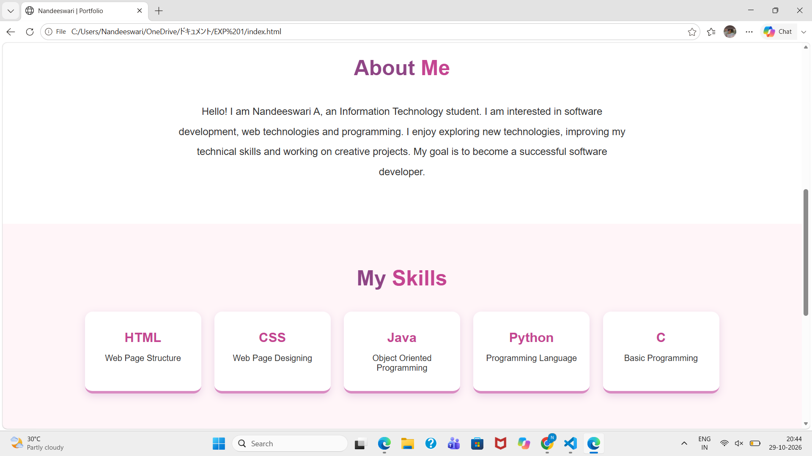
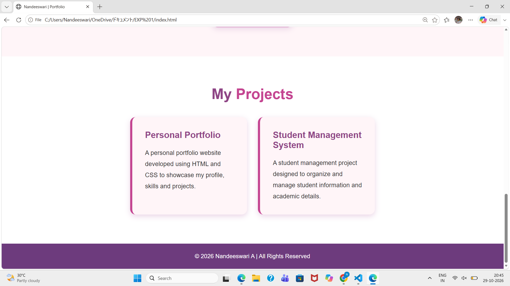

# portfolio
# Ex01 Portfolio
# Date: 29-10-2026
# AIM
To create a Portfolio using HTML and CSS.

# ALGORITHM
STEP 1
Create an HTML file (index.html)

STEP 2
Create a CSS file (style.css)

STEP 3
Include a navigation bar with links to different sections.

STEP 4
Add structured sections for introduction, about, projects, and contact details.

STEP 5
Define global styles for fonts, colors, and layout.

STEP 6
Style the header, navigation bar, and sections.

STEP 7
Use Flexbox or CSS Grid for layout design.

STEP 8
Add hover effects and transitions for interactivity.

STEP 9
Add Images and Media.

STEP 10
Use optimized images for a professional look.

STEP 11
Open the HTML file in a browser to check layout and functionality.

STEP 12
Fix styling issues and refine content placement.

STEP 13
Deploy the Portfolio.

STEP 14
Upload to GitHub Pages for free hosting.

# PROGRAM
## index.html
```

<!DOCTYPE html>
<html lang="en">

<head>
    <meta charset="UTF-8">
    <meta name="viewport" content="width=device-width, initial-scale=1.0">

    <title>Nandeeswari | Portfolio</title>

    <style>

        * {
            margin: 0;
            padding: 0;
            box-sizing: border-box;
            scroll-behavior: smooth;
        }

        body {
            font-family: Arial, sans-serif;
            background-color: #fff5f8;
            color: #333;
        }

        /* Navigation */

        header {
            background-color: #f3d9e8;
            padding: 25px 8%;
            display: flex;
            justify-content: space-between;
            align-items: center;
        }

        header h2 {
            color: #8e4585;
            font-size: 28px;
        }

        nav a {
            text-decoration: none;
            color: #5b365e;
            margin-left: 25px;
            font-size: 17px;
            font-weight: bold;
        }

        nav a:hover {
            color: #c44591;
        }

        /* Home */

        .home {
            min-height: 90vh;
            display: flex;
            justify-content: space-between;
            align-items: center;
            padding: 70px 10%;
            background: linear-gradient(
                135deg,
                #fff5f8,
                #f0e6ff
            );
        }

        .home-content {
            max-width: 600px;
        }

        .home-content h3 {
            font-size: 28px;
            color: #8e4585;
            margin-bottom: 15px;
        }

        .home-content h1 {
            font-size: 55px;
            color: #6d3b7d;
            margin-bottom: 15px;
        }

        .home-content h2 {
            font-size: 25px;
            color: #c44591;
            margin-bottom: 20px;
        }

        .home-content p {
            font-size: 18px;
            line-height: 1.8;
            margin-bottom: 30px;
        }

        .btn {
            display: inline-block;
            background-color: #c44591;
            color: white;
            padding: 15px 30px;
            border-radius: 30px;
            text-decoration: none;
            font-size: 17px;
            font-weight: bold;
        }

        .btn:hover {
            background-color: #8e4585;
        }

        /* Profile Photo */

        .home-image {
            display: flex;
            justify-content: center;
            align-items: center;
        }

        .home-image img {
            width: 300px;
            height: 300px;
            border-radius: 50%;
            object-fit: cover;
            border: 8px solid #e7b8d6;
            box-shadow: 0 0 25px #d9a5d4;
        }

        /* Common Section */

        section {
            padding: 80px 10%;
        }

        section h1 {
            text-align: center;
            font-size: 40px;
            color: #8e4585;
            margin-bottom: 40px;
        }

        section h1 span {
            color: #c44591;
        }

        /* About */

        .about {
            background-color: white;
        }

        .about p {
            max-width: 850px;
            margin: auto;
            text-align: center;
            font-size: 19px;
            line-height: 2;
        }

        /* Skills */

        .skills {
            background-color: #fff5f8;
        }

        .skills-container {
            display: flex;
            justify-content: center;
            flex-wrap: wrap;
            gap: 25px;
        }

        .skill-box {
            background-color: white;
            width: 220px;
            padding: 35px 20px;
            text-align: center;
            border-radius: 15px;
            box-shadow: 0 5px 15px #ead4e6;
            border-bottom: 5px solid #d98bc2;
        }

        .skill-box h2 {
            color: #c44591;
            font-size: 25px;
            margin-bottom: 15px;
        }

        .skill-box p {
            font-size: 16px;
        }

        .skill-box:hover {
            transform: translateY(-8px);
        }

        /* Projects */

        .projects {
            background-color: white;
        }

        .project-container {
            display: flex;
            justify-content: center;
            flex-wrap: wrap;
            gap: 30px;
        }

        .project-box {
            background-color: #fff5f8;
            width: 320px;
            padding: 35px;
            border-radius: 15px;
            border-left: 6px solid #c44591;
            box-shadow: 0 5px 15px #ead4e6;
        }

        .project-box h2 {
            color: #8e4585;
            margin-bottom: 20px;
        }

        .project-box p {
            line-height: 1.8;
            font-size: 17px;
        }

        /* Footer */

        footer {
            background-color: #6d3b7d;
            color: white;
            text-align: center;
            padding: 25px;
            font-size: 16px;
        }

        /* Responsive */

        @media (max-width: 768px) {

            header {
                flex-direction: column;
                gap: 20px;
            }

            nav {
                text-align: center;
            }

            nav a {
                display: inline-block;
                margin: 8px;
            }

            .home {
                flex-direction: column-reverse;
                text-align: center;
                gap: 40px;
            }

            .home-content h1 {
                font-size: 38px;
            }

            .home-image img {
                width: 220px;
                height: 220px;
            }

            section h1 {
                font-size: 32px;
            }

        }

    </style>

</head>

<body>

    <!-- Header -->

    <header>

        <h2>Portfolio</h2>

        <nav>
            <a href="#home">Home</a>
            <a href="#about">About</a>
            <a href="#skills">Skills</a>
            <a href="#projects">Projects</a>
            <a href="#contact">Contact</a>
        </nav>

    </header>

    <!-- Home -->

    <section class="home" id="home">

        <div class="home-content">

            <h3>Hello, Welcome!</h3>

            <h1>I'm Nandeeswari A</h1>

            <h2>Information Technology Student</h2>

            <p>
                I am passionate about technology, programming
                and web development. I love learning new skills
                and creating beautiful websites.
            </p>

            <a href="#about" class="btn">About Me</a>

        </div>

        <div class="home-image">

            

        </div>

    </section>

    <!-- About -->

    <section class="about" id="about">

        <h1>About <span>Me</span></h1>

        <p>
            Hello! I am Nandeeswari A, an Information Technology
            student. I am interested in software development,
            web technologies and programming.
            I enjoy exploring new technologies, improving my
            technical skills and working on creative projects.
            My goal is to become a successful software developer.
        </p>

    </section>

    <!-- Skills -->

    <section class="skills" id="skills">

        <h1>My <span>Skills</span></h1>

        <div class="skills-container">

            <div class="skill-box">
                <h2>HTML</h2>
                <p>Web Page Structure</p>
            </div>

            <div class="skill-box">
                <h2>CSS</h2>
                <p>Web Page Designing</p>
            </div>

            <div class="skill-box">
                <h2>Java</h2>
                <p>Object Oriented Programming</p>
            </div>

            <div class="skill-box">
                <h2>Python</h2>
                <p>Programming Language</p>
            </div>

            <div class="skill-box">
                <h2>C</h2>
                <p>Basic Programming</p>
            </div>

        </div>

    </section>

    <!-- Projects -->

    <section class="projects" id="projects">

        <h1>My <span>Projects</span></h1>

        <div class="project-container">

            <div class="project-box">

                <h2>Personal Portfolio</h2>

                <p>
                    A personal portfolio website developed using
                    HTML and CSS to showcase my profile, skills
                    and projects.
                </p>

            </div>

            <div class="project-box">

                <h2>Student Management System</h2>

                <p>
                    A student management project designed to
                    organize and manage student information
                    and academic details.
                </p>

            </div>

        </div>

    </section>


    <!-- Footer -->

    <footer>

        <p>
            © 2026 Nandeeswari A | All Rights Reserved
        </p>

    </footer>

</body>

</html>
```

# OUTPUT








# RESULT
The program for creating Portfolio using HTML and CSS is executed successfully.